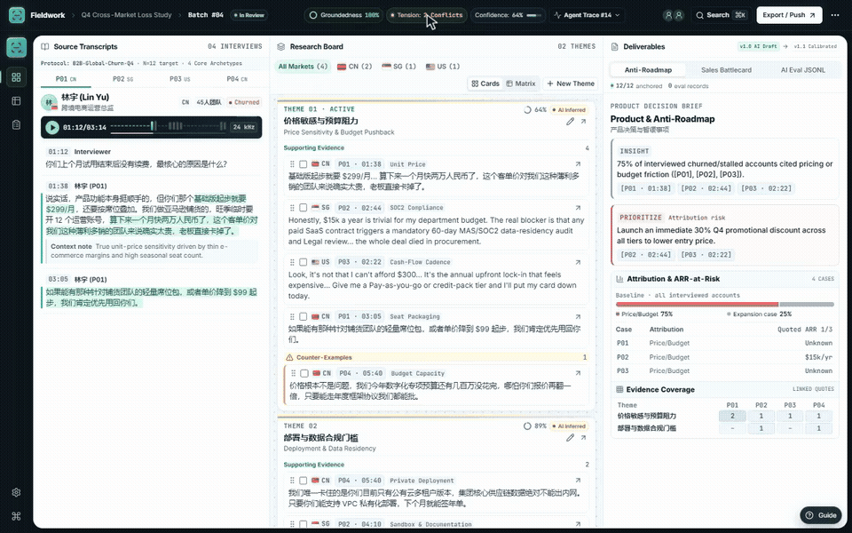

# Fieldwork Studio

[打开工作台](https://chengtaoxu23-prog.github.io/fieldwork-studio/) · [播放视频](https://chengtaoxu23-prog.github.io/fieldwork-studio/media/) · [下载 MP4](media/workbench.mp4)

## 项目定位

Fieldwork Studio 是一个**以访谈原文为锚点的研究校准工作台**。它处理从多市场访谈到产品决策之间最容易出错的一步：模型把表面相似的反馈归为同一原因，而访谈原文指向不同的采购门槛。研究人员可以逐条核查、重分主题、保留反证，并把人工纠偏沉淀成可追溯的评估样本。

## 工作台与功能

| 模块 | 可操作能力 |
|---|---|
| Source Transcripts | 浏览中国、新加坡和美国访谈样例，按受访者切换双语原文，查看市场、角色、团队规模、采购阶段与金额上下文。引用和交付物中的时间戳可跳回原段落。环境支持时可使用朗读和音频位置控件。 |
| Research Board | 按市场过滤证据，在主题卡和跨市场矩阵间切换。主题卡区分支持证据和反例，含引用定位、主题名称编辑与证据血缘入口。 |
| 人工复核与重归因 | 逐条核验 AI 初判，使用证据卡操作或拖放调整主题归属。支持创建主题、选择证据和记录人工校准结果，保留初判、人工修订和对应引文。 |
| Evidence Matrix | 按主题和受访者核对证据覆盖，区分支持片段、反例和缺失证据。矩阵单元格可回到相关引用与原文。 |
| Product & Anti-Roadmap | 从初始判断切换到校准后的产品决策与暂缓事项，对照归因变化、按样例计算的金额语境和证据覆盖。用反例识别应该暂缓的策略。 |
| Sales Battlecard | 把经过校准的客户异议转成销售话术与下一步动作，保留可追溯的访谈出处。可检查交接载荷，并通过模拟同步预览送往 GTM 的流程。 |
| AI Eval 与审计 | 人工纠偏记录可查看、复制或导出为 JSONL。评估用例把模型判断与人工标签绑定到原文片段，便于后续复盘和回归检查。工作区还提供审计视图和 Agent Trace。 |
| 工作区操作 | 支持全局搜索、快捷键和引导，记录证据覆盖、冲突与置信度变化。校准状态保存在当前浏览器，可恢复样例基线。 |

## 一条完整的校准路径

以新加坡案例为例，从「价格敏感」主题卡点击 **P02 · 02:44**。原文显示预算措辞背后是合规与法务审批约束。把这条信号重归因后，对照更新后的主题卡和 Anti-Roadmap，检查降价建议是否仍有足够的证据。最后查看 Sales Battlecard 和 AI Eval JSONL，确认修订结果可定位、可复核、可导出。

工作台内置访谈、金额、置信度与交接状态均用于合成案例走查。录屏展示了从原文定位、证据重归因到评估导出的操作流程。
